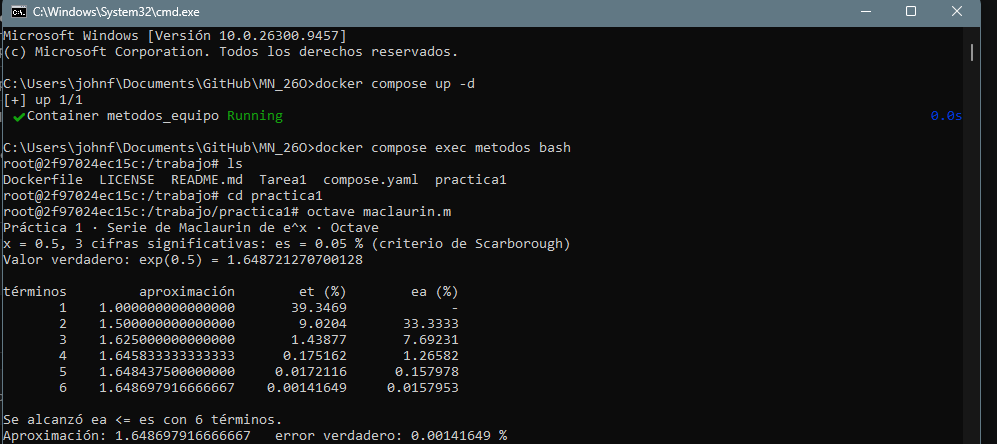
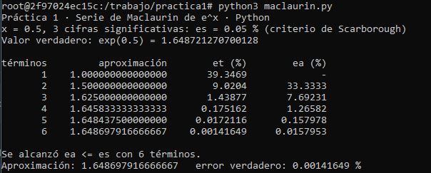
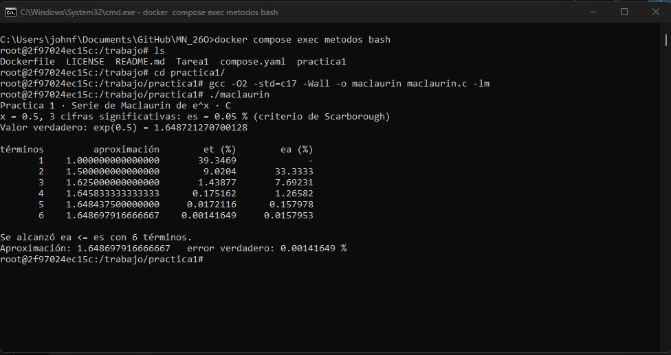

# Práctica 1 · La serie de Maclaurin y el criterio de paro

**UEA 1151039 · Métodos Numéricos en Ingeniería · Trimestre 26-O · UAM Azcapotzalco**
**Profesor:** M. en C. Gabriel Hurtado Avilés

| | |
|---|---|
| Equipo | |
| Integrantes | Fernandez Gonzalez Juan José, 2223036835, Ing. Mecánica |
| Repositorio de la Tarea 1 de | Fernandez Gonzalez Juan José |
| Fecha | 12/10/2026 |

## 1. Octave y Python




¿Coinciden con la lámina 25 de la unidad I?
No, pues la tabla de la lamina 25 de la unidad I contiene un termino adicional, o sea 7. Ademas de los numeros cuentan con menos cifras significativas.

## 2. Las dos líneas que completamos en `maclaurin.c`

```c
/* COMPLETAR 1 */
termino = termino * X/n;
/* COMPLETAR 2 */
ea = fabs((aprox - anterior)/aprox) * 100;
```



## 3. Más cifras significativas

| Cifras | εs (%) | Términos | Aproximación | Error verdadero (%) |
|---|---|---|---|---|
| 3 |  0.05  |  6  |  1.648697916666667  | 0.00141649   |
| 6 |  0.00005  |  9  |  1.648721265035962  |  0.000000343549  |
| 17 |  5 × 10⁻¹⁶  | 16   |  1.648721270700128  |  0.0000000000000269354  |

1. ¿Cuántos términos hacen falta en cada caso?
   Para cuando se tienen 3 cifras hacen falta 10 términos, para 6 cifras faltan 6 términos y para 17 terminan sobrando 2.
2. En cada fila de la tabla, ¿εa es mayor o menor que εt? ¿Por qué conviene detenerse con εa?
   En cada fila εa es mayor que εt. Y conviene detenerse con εa porque esta viene siendo el la diferencia de las aproximaciones  por 100, y esta da cero o esta tendiendo a cero, significa que se esta obteniendo el mismo numero en la iteración. O en otras palabras, entre mas chico sea εa, menos cambios tendrán las cifras de la aproximación calculada.
   
3. Con 17 cifras el programa termina. ¿Cuántas cifras del resultado son correctas en realidad?
   Relaciónenlo con 0.1 + 0.2 de la Tarea 1.

   Contando después del punto decimal, hay 13 cifras correctas que coinciden con el valor de la lamina 25 de la unidad I. Terminan sobrando 2 cifras. 

## Uso de inteligencia artificial

Ninguno.

## Referencias
[1] Chapra, S. C., & Canale, R. P. (2015). Métodos Numéricos para Ingenieros (7a ed.). McGraw-Hill.
[2] Burden, R. L., & Faires, J. D. (2011). Análisis Numérico (9a ed.). Cengage Learning.
