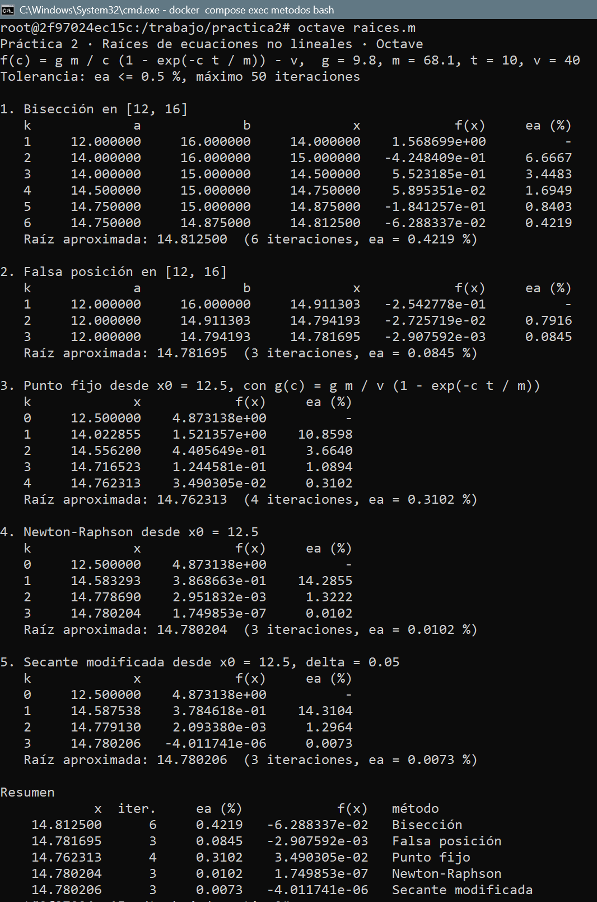
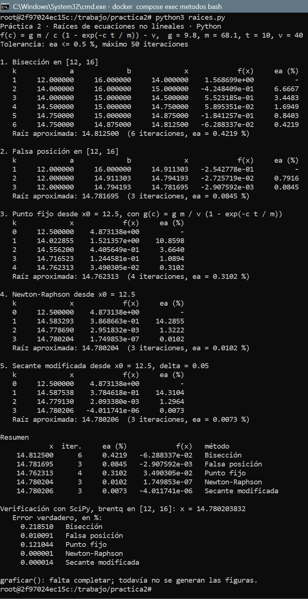
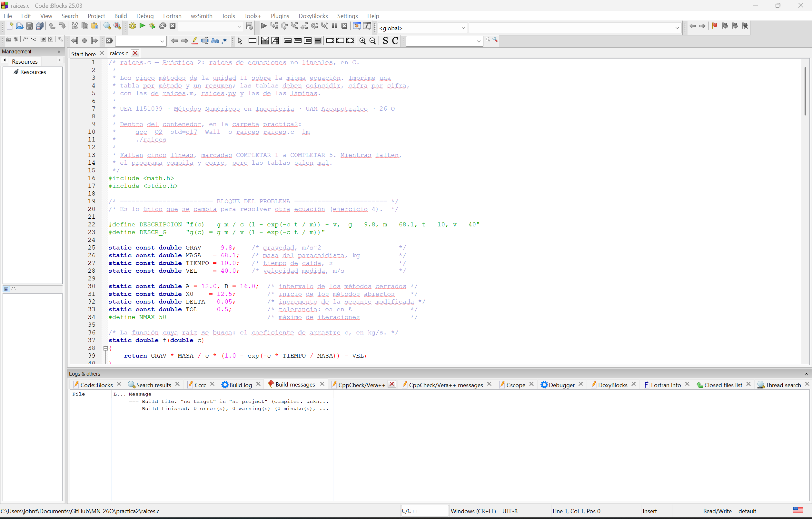
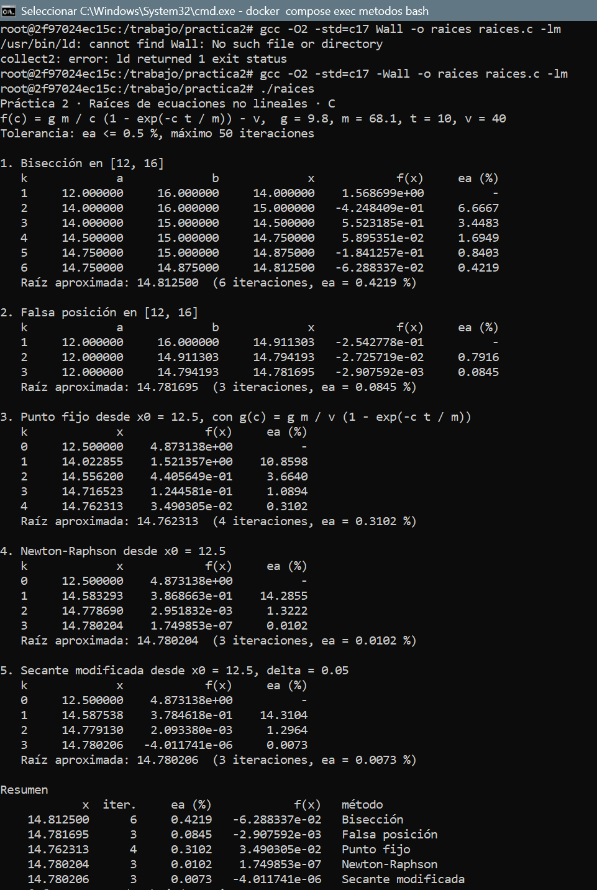
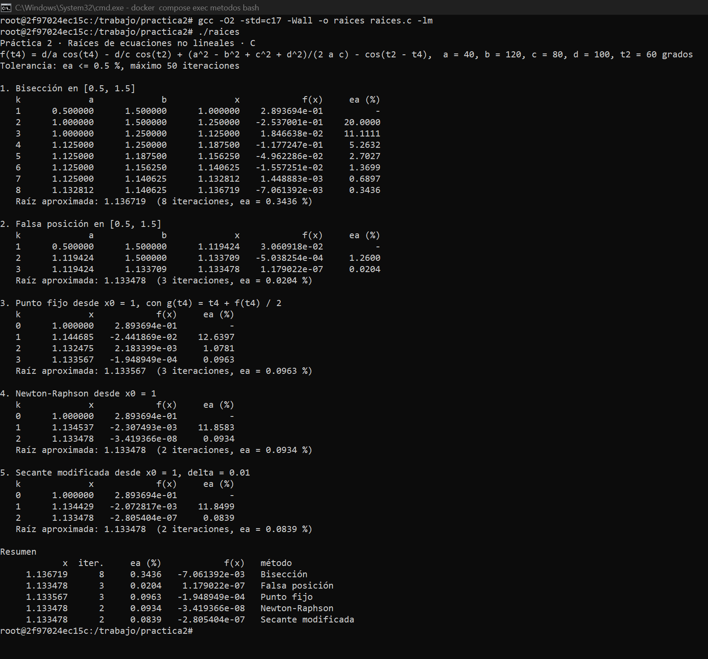
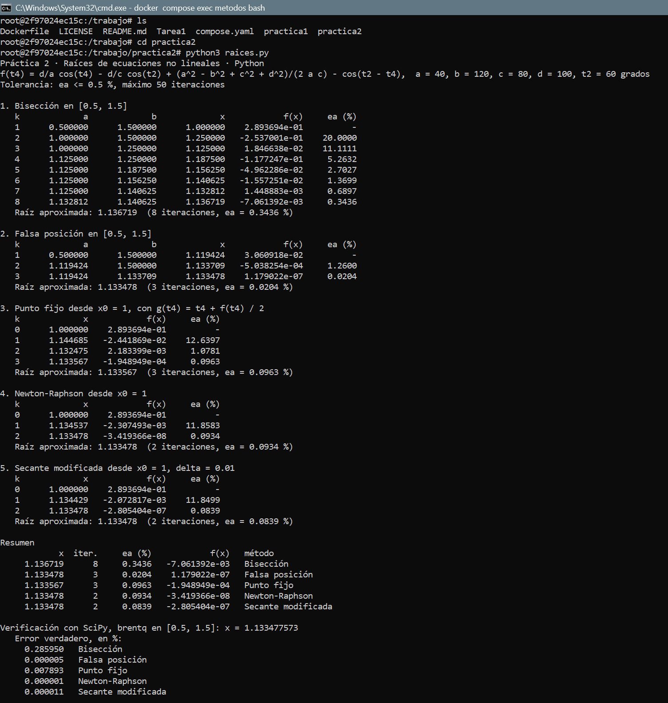

# Práctica 2 · Raíces de ecuaciones no lineales

**UEA 1151039 · Métodos Numéricos en Ingeniería · Trimestre 26-O · UAM Azcapotzalco**
**Profesor:** M. en C. Gabriel Hurtado Avilés

| | |
|---|---|
| Equipo | |
| Integrantes | Fernandez Gonzalez Juan José, 2223036835, Ing. Mecánica|
| Ecuación asignada | 22 · Mecanismo de cuatro barras: ángulo del balancín (Freudenstein) |
| Fecha |16 de octubre de 2026 |

---

## 1. Octave y Python con el paracaidista

Capturas de `octave raices.m` y de `python3 raices.py` sin cambiar nada. Sus tablas
coinciden con las de las láminas de la unidad II.




## 2. Las cinco líneas que completamos en `raices.c`

```c
/* COMPLETAR 1 */
return fabs((nuevo - anterior)/ nuevo) * 100;
/* COMPLETAR 2 */
x = b - f(b) * (a - b) / (f(a) - f(b));
/* COMPLETAR 3 */
x_nuevo = g(x);
/* COMPLETAR 4 */
x_nuevo =  x - f(x) / fp(x);
/* COMPLETAR 5 */
x_nuevo =  x - delta * f(x) / (f(x + delta) - f(x));
```




¿Coinciden las tablas de C con las de Octave y Python? Sí / No, y en qué.

## 3. Las gráficas de Python


## 4. Nuestra ecuación

| | |
|---|---|
| f(x) | |
| f'(x) | |
| g(x) | |
| Intervalo [a, b] | |
| x₀ y δ | |
| Tolerancia | εa ≤ 0.5 % |




### Tablas (salida de C)

**Bisección**

| k | a | b | x | f(x) | εa (%) |
|---|---|---|---|---|---|
| 1 | | | | | — |
| 2 | | | | | |

**Falsa posición**

| k | a | b | x | f(x) | εa (%) |
|---|---|---|---|---|---|
| 1 | | | | | — |
| 2 | | | | | |

**Punto fijo**

| k | x | f(x) | εa (%) |
|---|---|---|---|
| 0 | | | — |
| 1 | | | |

**Newton-Raphson**

| k | x | f(x) | εa (%) |
|---|---|---|---|
| 0 | | | — |
| 1 | | | |

**Secante modificada**

| k | x | f(x) | εa (%) |
|---|---|---|---|
| 0 | | | — |
| 1 | | | |

Agreguen las filas que hagan falta.

### Resumen

| Método | Raíz | Iteraciones | εa (%) | f(raíz) | Error verdadero (%) |
|---|---|---|---|---|---|
| Bisección | | | | | |
| Falsa posición | | | | | |
| Punto fijo | | | | | |
| Newton-Raphson | | | | | |
| Secante modificada | | | | | |

Raíz de referencia (SciPy):

### Análisis

¿Qué método necesitó menos iteraciones y cuál más? ¿Por qué los cinco no dan
exactamente el mismo número? ¿Alguno no alcanzó la tolerancia o tardó mucho más que
los otros? ¿Por qué?

## 5. Cada integrante en su computadora

Cada integrante corre `raices.c` con la ecuación del equipo en su propia computadora y sube
su captura con un commit propio (ver `COMO_CORRER.md`, sección 7).

| Integrante | Usuario de GitHub | Captura |
|---|---|---|
| | | `img/07-integrante-apellido.png` |
| | | |
| | | |


## Uso de inteligencia artificial

Ninguno / Cuál y para qué.

## Referencias

